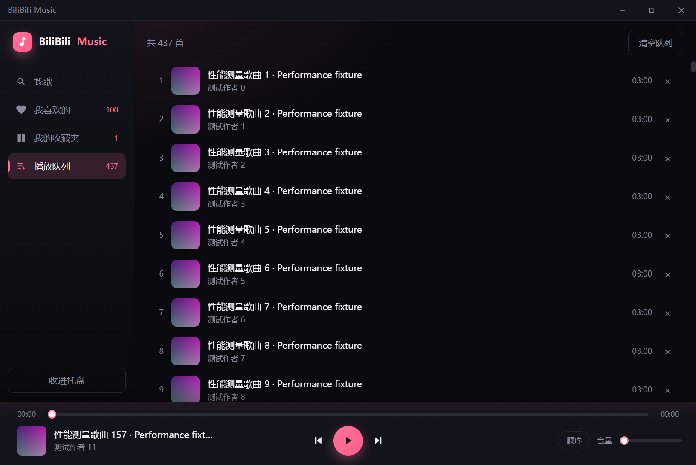
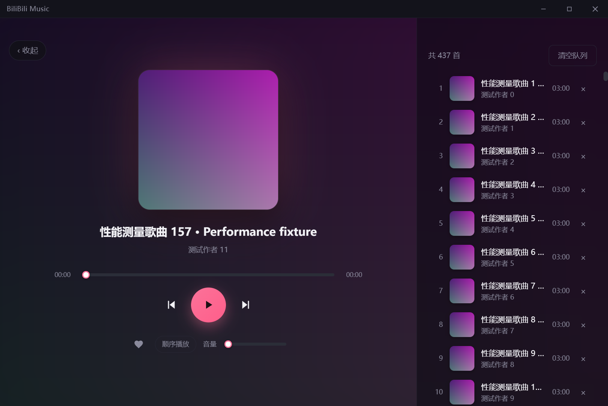

# BiliBili Music

一个使用 Electron、Vue 3 和 TypeScript 编写的 Windows 桌面播放器，把公开的 B 站音乐视频组织成播放队列。无需登录，支持搜索、公开收藏夹、喜欢列表和托盘播放。

本项目是个人学习与实验项目，与哔哩哔哩没有隶属或合作关系。目前支持 Windows 10/11 x64，当前公开版本为 `v0.1.1` 测试版。





截图使用合成歌曲和封面演示界面，不包含用户收藏或音乐内容。

## 下载与运行

从 [Releases](https://github.com/2155881379-bot/BiliBili-Music/releases) 页面下载 Windows x64 版本：

| 文件 | 用途 |
| --- | --- |
| `BiliBiliMusic-Setup-0.1.1.exe` | 安装向导，可选择安装目录并创建快捷方式 |
| `BiliBiliMusic-Portable-0.1.1.exe` | 免安装启动；用户数据仍保存在系统应用数据目录 |
| `SHA256SUMS.txt` | 下载文件的 SHA-256 校验值 |

`v0.1.1` 修复了打开“正在播放”后窗口按钮和“收起”无法点击的问题，建议 `v0.1.0` 用户升级。

运行前先从旧版托盘菜单选择“退出”。应用只允许一个实例，新启动请求会激活已运行的窗口。

发布包暂未配置代码签名，Windows 可能显示发布者或 SmartScreen 提示。请核对下载来源与校验值，再自行决定是否运行。不要全局关闭系统安全保护。

在 PowerShell 中核对文件：

```powershell
Get-FileHash .\BiliBiliMusic-Portable-0.1.1.exe -Algorithm SHA256
```

## 功能

- 搜索公开视频并加入队列，支持“下一首播放”。
- 保存、同步公开收藏夹，按标题或 UP 主筛选。
- 喜欢列表、播放进度和音量恢复。
- 顺序播放、单曲循环、随机播放；多 P 视频按分 P 展开。
- 队列拖拽排序、跨视口拖动和边缘自动滚动。
- 托盘播放、系统媒体控制和单实例窗口。
- 长列表虚拟化、按显示尺寸加载封面，减少 DOM 与大图解码开销。

应用窗口内的快捷键（输入框编辑时不触发）：

| 按键 | 操作 |
| --- | --- |
| `Space` | 播放 / 暂停 |
| `Ctrl + →` / `Ctrl + ←` | 下一首 / 上一首 |
| `Ctrl + K` | 聚焦搜索框 |
| `Esc` | 收起“正在播放” |

## 从源码运行

需要 Git、Node.js 22.12+（推荐 Node.js 24 LTS）以及 npm。Windows x64 是目前验证的运行和打包平台。

在仓库页面点击 **Code** 复制 HTTPS 地址，然后：

```powershell
git clone https://github.com/2155881379-bot/BiliBili-Music.git
cd BiliBili-Music
npm ci
npm run dev
```

`npm ci` 根据已提交的 `package-lock.json` 安装依赖，适合复现构建。首次安装会下载 Electron，需要可访问 npm 和 Electron 下载服务。

常用命令：

| 命令 | 作用 |
| --- | --- |
| `npm run dev` | 启动开发环境 |
| `npm test` | 模块测试和属性测试 |
| `npm run typecheck` | TypeScript 与 Vue 类型检查 |
| `npm run build` | 编译主进程、预加载脚本和界面到 `out/` |
| `npm start` | 运行已经编译的应用 |
| `npm run dist` | 构建 Windows 安装包和便携版到 `release/` |
| `npm run test:perf` | Windows 隔离 Electron 交互与性能回归，先执行构建 |

网络受限时，可在自己的 PowerShell 会话中临时配置镜像，无需修改仓库文件：

```powershell
$env:ELECTRON_MIRROR = 'https://npmmirror.com/mirrors/electron/'
npm ci --registry=https://registry.npmmirror.com
```

项目默认使用官方 npm registry。镜像属于第三方服务，请按自己的网络环境选择。

## 用户数据与网络

队列、收藏夹、喜欢列表和进度保存在 `%APPDATA%\bilibili-music\state.json`。升级前可退出应用并备份此文件。Chromium 的缓存也位于应用数据目录；便携版不是把所有数据都放在 exe 旁边。

应用会直接访问 B 站接口及音视频/图片 CDN，请求包含搜索词、视频标识和收藏夹标识。匿名访问会使用 B 站分配的 Cookie，不要求账号登录。源码不含自建统计上报服务，也不托管音乐文件。

## 已知限制

- 非官方接口可能变化或触发风控（例如 HTTP 412），匿名访问也不保证所有视频可播。
- 只支持可公开访问的内容；失效、权限限制、地区限制的视频可能无法播放。
- HTML Audio 播放不提供位完美输出、独占模式或专业音频链路。
- 暂无自动更新；新版本需要手动下载安装。
- 首次公开版仍需更广泛验证真实网络、长时间播放、多显示器及系统媒体键。
- Electron 有固定的运行时和缓存成本。优化不等于几十 MiB 常驻，见[性能测量说明](docs/PERFORMANCE.md)。

请遵守 B 站服务条款及内容授权。MIT 许可证适用于本仓库代码，不授予第三方音视频、封面或商标的使用权。

## 项目结构

```text
src/main/          Electron 主进程、B 站请求、状态文件与托盘
src/preload/       界面可调用的 IPC 接口
src/renderer/      Vue 界面、Pinia 状态与列表逻辑
src/shared/        共享 TypeScript 类型
tests/             模块与属性测试
scripts/           隔离性能回归与打包验收脚本
.github/workflows/ 自动检查与手动构建流程
docs/              性能说明、开发与发布流程
```

欢迎通过 [Issues](https://github.com/2155881379-bot/BiliBili-Music/issues) 报告问题，通过 [Pull requests](https://github.com/2155881379-bot/BiliBili-Music/pulls) 提交改动。提交前请运行测试、类型检查与构建，见[贡献说明](CONTRIBUTING.md)。

## 许可与参考

本项目采用 [MIT License](LICENSE)。打包依赖及其版权说明见 [THIRD-PARTY-NOTICES.txt](THIRD-PARTY-NOTICES.txt)。Electron/Chromium 的许可证随分发包保留。

性能优化时参考了 [EchoMusic](https://github.com/hoowhoami/EchoMusic) 在虚拟列表、封面尺寸和生命周期方面的设计思路，本项目没有引入其 Rust 音频引擎，也没有复制其源文件。
